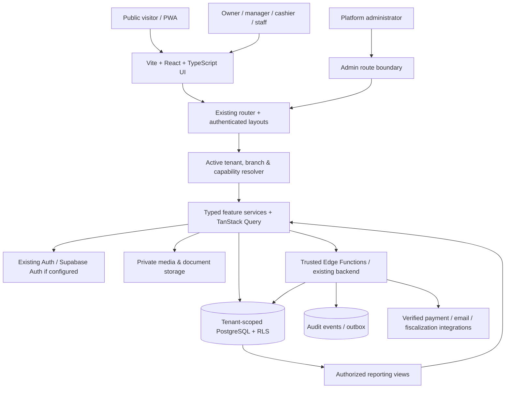

# DukaPro — Application & Data Architecture
> **Project:** DukaPro — multi-tenant retail operations SaaS. **Status:** Proposed specification derived from supplied UI references; not an audit of deployed code, database, integrations, or business claims.
> **Existing project rule:** Inspect and extend the current application. Preserve Vite + React + TypeScript + Tailwind CSS + shadcn/ui. Use the connected backend already configured in the repository; Supabase is the target only where it is actually the existing backend. Never silently migrate frameworks, databases, or auth.
> **Visual authority:** Supplied dark DukaPro screenshots for current dashboard screens; the ten-panel composite for landing, platform admin, owner, cashier POS, inventory, sales, customers, suppliers, expenses and settings. Where references differ, retain established working flows and unify tokens without deleting features.

## 1. Logical system diagram


## 2. Architecture layers
1. Presentation: reusable shadcn/ui primitives, theme tokens, responsive app shell, charts, forms and POS keyboard/scanner UX.
2. Route/auth boundary: session validation, platform-vs-tenant routes, branch selector, capability-aware navigation; never rely on UI checks alone.
3. Domain feature layer: inventory, checkout, purchases, customers, suppliers, receivables, finance, staff, branches, reports, subscriptions and administration.
4. Data access: typed queries/mutations; server-side authorization and tenant-scoped constraints; query cache keys include tenant and branch; invalidate on context switch.
5. Trusted operations: atomic sale settlement/stock movements, payments, refunds, subscription entitlements, import processing and document numbering.
6. Observability: immutable audit logs, error monitoring, performance metrics, background-job retries and reconciliation.

## 3. Proposed repository structure — ADAPT TO EXISTING TREE
```text
src/
  app/
    providers/              # auth, query, theme, notifications
    router/                 # public, tenant, POS, admin route boundaries
    layouts/                # MarketingLayout, BusinessLayout, POSLayout, AdminLayout
  components/
    ui/                     # existing shadcn components (reuse)
    shell/                  # Sidebar, Topbar, SubscriptionBanner, BranchSwitcher
    tables/                 # filters, sorting, pagination, export
    charts/                 # shared measured-data chart components
    forms/                  # controlled fields, validation, dialogs
  features/
    onboarding/
    dashboard/
    pos/
    sales/
    inventory/
    stock-alerts/
    stock-movements/
    purchases/
    suppliers/
    customers/
    receivables/
    expenses/
    transactions/
    branches/
    staff/
    reports/
    downloads/
    profile/
    business-settings/
    subscriptions/
    platform-admin/
    capabilities/           # variant, restaurant, wallet, credit toggles
  hooks/                    # existing hooks; avoid parallel duplicates
  lib/
    api/                    # typed feature service clients
    auth/                   # session and permission helpers
    money/                  # decimal-safe arithmetic and formatting
    dates/                  # tenant timezone and date ranges
    validation/             # Zod schemas
    theme/                  # semantic dark/light tokens
    telemetry/              # real event instrumentation
  types/                    # generated database types and domain contracts
supabase/                   # only if Supabase already configured
  migrations/               # additive versioned migrations
  functions/                # privileged operations, if existing runtime
  tests/                    # RLS and integration tests
public/                     # installable PWA assets if enabled
```
Do not create all directories merely for appearance. Map actual routes, names, aliases and modules before refactoring.

## 4. Tenant and role model
- `auth.users` or existing auth identity: canonical UUID user.
- `profiles`: user display data, theme preference, no self-editable admin grants.
- `businesses`: tenant with registered details, operating mode, default currency and country.
- `business_members`: membership, role, status, invitation, permission overrides.
- `branches`: tenant-owned locations, status, contact, manager assignment.
- `branch_staff`: membership-to-branch assignment and optional local permissions.
- `platform_roles`: independently verified platform operators.
- `capability_entitlements`: business feature toggles and subscription constraints, enforced server-side.

## 5. Conceptual data model (reuse actual tables)
| Domain | Canonical entities | Critical invariant |
|---|---|---|
| Catalog | products, categories, product_variants, units, barcodes | Business ownership, unique scoped SKU |
| Inventory | branch_inventory, stock_movements, transfers, stock_counts | Atomic quantity changes and immutable movement history |
| Sales | sales, sale_items, sale_payments, returns, refunds | Unique receipt/ref; frozen price/tax snapshot; idempotent checkout |
| Customers | customers, customer_ledger, receivable_allocations | No double allocation; tenant scope |
| Suppliers | suppliers, supplier_ledger, payable_allocations | Supplier liability reconciles to purchases/payments |
| Purchases | purchase_orders, purchase_items, goods_receipts, purchase_returns | Stock only increases on confirmed receipt |
| Expenses | expenses, expense_categories, recurring_expenses | Currency, approval, actor and branch |
| Staff | business_members, branch_staff, invitations, roles | Server-enforced least privilege |
| Business | businesses, branches, business_settings, capabilities | Tenant isolation; controlled settings changes |
| Billing | plans, subscriptions, invoices, payment_attempts, promotions | Real processor/verified manual payment status |
| Events | transaction_events, audit_logs, outbox_events | Append-only provenance, idempotency |

Use UUID primary keys, tenant IDs, timestamps, FK constraints, unique scoped indexes and appropriate composite tenant integrity. Money should use NUMERIC with defined scale or smallest units, consistently; quantities support decimal-safe units when enabled.

## 6. Core workflows
### Sale checkout
Validate member/branch and permissions → read current sellable stock/price → create immutable sale snapshot → authorize/record payment according to verified method → atomically commit sale, stock movement and financial ledger → emit receipt and audit event → return idempotent result. Retry must not create a second sale or decrement stock again.
### Purchase receiving
Create PO → approve (if required) → record goods receipt against PO → update stock in one transaction → create payable entries → allocate verified supplier payments → reconcile.
### Branch transfer
Initiate transfer → reserve/dispatch from source → receive into destination → record two-sided movement events and any discrepancy; no direct client quantity edits.
### Customer credit
Enable entitlement → configure limits → create sale receivable → record payment allocation → update outstanding ledger and aging reports. Credit balance must derive from ledger, not manually editable counter.
### Subscription
Tenant subscription status and entitlement come from trusted billing records; expiry banners compute from server timestamps; never grant paid access because a client clicked Activate.

## 7. Authorization and data boundaries
Every business table is scoped by business_id and branch_id where relevant. Validate membership and permission on every query/mutation; tenant IDs in URLs are selectors, not proof. RLS on direct DB access; trusted server checks for privileged actions; prohibit cross-tenant joins and storage leaks. Platform admin rights must be independently managed. Use private storage buckets for sensitive documents and short-lived signed links.

## 8. Reporting and reconciliation
KPI queries are defined from canonical events with explicit date boundaries, timezone, currency and statuses. Stock value = sum(on-hand × unit cost policy); potential profit is *not* realized profit; realized margin requires sale item cost snapshots and refunds. Use materialized/aggregated views only with freshness guarantees. Track import/export job provenance.

## 9. Delivery architecture gates
Phase 0 inventory and schema map → auth/tenant RLS → design tokens/layout → core catalog/branches/staff → POS/stock ledger → purchasing/credit → reports/transactions → admin/subscriptions → integration verification → accessibility/security/load tests. Each phase includes migration rollback and test evidence.
